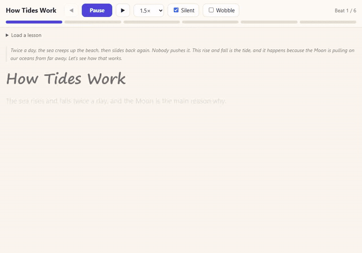

# Pencil: narrated whiteboard lesson prototype

A small open-source take on the "AI teacher that draws on a whiteboard" idea: a model writes a
lesson as strict JSON, code validates it, and a browser player draws it in time with the narration.
Everything here (prompts, schema, player) is original code.

**[Live demo](https://vbs2004.github.io/pencil/)**: a lesson written by DeepSeek, played by the single-file player (press Play, untick "Silent" for voice).



```
topic --> planner.py --(LLM)--> lesson.json --> validator.js --(issues)--> repair loop
                                                      |
                                                      v
                                       player.html (SVG draw-on + speech, cues by word index)
```

## Quick start

```bash
open player.html                       # plays the built-in rainbow sample (no server needed)
node validator.js samples/rainbow.json # exit 0 = valid; prints issues as JSON otherwise

export DEEPSEEK_API_KEY=...           # default provider; stdlib only, no pip install needed
python3 planner.py --topic "How tides work" --minutes 4 --out lesson.json \
    --price-in <USD per 1M input tokens> --price-out <USD per 1M output tokens> --inr-per-usd 88
# then open player.html, "Load a lesson", pick lesson.json
# or: python3 -m http.server and open player.html?src=lesson.json&autoplay=1

# Anthropic instead: pip install anthropic; export ANTHROPIC_API_KEY=...; add --provider anthropic
```

`--model` (or env `LESSON_MODEL`) picks the model; the default is `deepseek-flash`. Prices are
inputs on purpose: the planner prints tokens and cost per lesson so you can measure your real number.
`--topic -` reads the topic from stdin; `--research-file` adds reference notes; `--dry-run` prints the prompts.

## Lesson format

`beats[]` each hold `narration` plus `ops[]`: `heading`, `paragraph`, `callout`, `definition`,
`table`, `figure`. A figure is `parts[]` of `marks[]` (`circle`, `ellipse`, `rect`, `line`, `path`,
`label`). Each part has a `cue`: the index of the narration word at which it is drawn. Paths use
absolute commands only. `checks[]` are end-of-lesson multiple-choice questions.

## Tests

```bash
python3 -m unittest test_planner   # repair loop, parsing, cost math (fake LLM, no key needed)
python3 test_player.py             # headless Chrome: playback, quiz, bad input, XSS safety
python3 build.py                   # regenerate player.html from player.template.html
```

## Known limits

- Unit tests use a scripted fake model; live runs have been done with DeepSeek (`deepseek-flash`). The Anthropic path is untested live.
- Narration uses the browser's built-in speech synthesis. Swap in an on-device TTS for a consistent voice.
- The wobble effect is opt-in: the SVG displacement filter can leave small notches in thin strokes.
- No accounts, storage, uploads, video export or billing.
